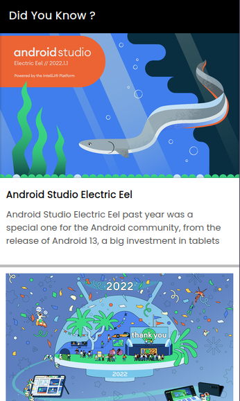

# Did You Know | A blogging app

A very simple blog app backed with a nodejs server and a webclient as well, you get the Android app client in this repo, down there is a simple preview image.

## Features

1. Simple CURD operations from Android client (Admin)
2. Web client is Read-Only (Users)
3. Likes and Dislikes (Right now its not on a persistent server)
4. Image uploads to firebase
5. Uses firestore as database

  

